Some questions need more than a filter. These are written, checked on the ground, and dated.

  <button class="pill" type="button" data-season="winter" aria-pressed="false">❄️ winter</button>
  <button class="pill" type="button" data-season="summer" aria-pressed="false">☀️ summer</button>
  <button class="pill" type="button" data-season="all-year" aria-pressed="false">🗓️ all year</button>

<section class="artsec" id="winter">
<h2 class="artsec-title">❄️ Winter</h2>

Skiing from Florence, and where to eat and sleep in the mountains.

  <a class="artcard has-photo" href="/articles/skiing-from-florence/">
    
    Day trips and weekends
    <h2>Where to go skiing from Florence this winter</h2>
    
Fourteen ski areas sorted by driving time: two hours, four to five, and five or more. 2026/27 lift prices, size and altitude for each.

    Researched November 2026 &middot; 14 ski areas
  </a>
  <a class="artcard has-photo" href="/articles/where-to-eat-and-stay-in-ponte-di-legno/">
    
    Ski food guide
    <h2>Ponte di Legno and the Tonale: a weekend on the snow</h2>
    
Casoncelli, gnoc de la cua and Silter cheese. Dinner in the valley, huts on the slopes, and which village to sleep in.

    Researched November 2026
  </a>
  <a class="artcard has-photo" href="/articles/where-to-eat-and-stay-in-the-dolomites/">
    
    Ski food guide
    <h2>The Dolomites from Florence: three valleys, three weekends</h2>
    
Val Gardena, Cortina and Madonna di Campiglio: a dinner, a mountain hut and a hotel in each.

    Researched November 2026
  </a>
  <a class="artcard has-photo" href="/articles/where-to-eat-and-stay-in-abetone/">
    
    Ski food guide
    <h2>Abetone: a day on the snow from Florence</h2>
    
Ski at Abetone, eat in Cutigliano. A Bib Gourmand trattoria, tortelli at a refuge, and two hotels by the lifts.

    Researched November 2026
  </a>
  <a class="artcard has-photo" href="/articles/where-to-eat-and-stay-on-the-cimone/">
    
    Ski food guide
    <h2>The Cimone: skiing with the best food in the Apennines</h2>
    
Tigelle country. A medieval inn near Sestola, a refuge hotel at the lifts, and where to eat in Fanano.

    Researched November 2026
  </a>
  <a class="artcard has-photo" href="/articles/where-to-eat-and-stay-in-val-gardena/">
    
    Ski guide
    <h2>Val Gardena: wooden villages and the Sellaronda</h2>
    
The Dolomites trip that works by train. Seceda, Selva, Ortisei and the huts worth the stop.

    Researched November 2026
  </a>
  <a class="artcard has-photo" href="/articles/where-to-eat-and-stay-in-cortina/">
    
    Ski guide
    <h2>Cortina: the most beautiful skiing in the Dolomites</h2>
    
Lagazuoi, Cinque Torri, Rifugio Averau and a Michelin star in town.

    Researched November 2026
  </a>
  <a class="artcard has-photo" href="/articles/where-to-eat-and-stay-in-madonna-di-campiglio/">
    
    Ski guide
    <h2>Madonna di Campiglio: polished slopes under the Brenta</h2>
    
Groomed runs, a walkable village, lunch at the Spinale and the Grostè.

    Researched November 2026
  </a>
  <a class="artcard has-photo" href="/articles/where-to-eat-and-stay-at-corno-alle-scale/">
    
    Ski guide
    <h2>Corno alle Scale: small, wild and quiet</h2>
    
The emptiest snow within two hours of Florence, inside a regional park.

    Researched November 2026
  </a>
  <a class="artcard has-photo" href="/articles/where-to-eat-and-stay-in-livigno/">
    
    Ski guide
    <h2>Livigno: high, cold and full of snow</h2>
    
Snow from November to May, two ski sides, pizzoccheri and sciatt, and duty-free evenings.

    Researched November 2026
  </a>
  <a class="artcard has-photo" href="/articles/where-to-eat-and-stay-in-cervinia/">
    
    Ski food guide
    <h2>Cervinia: skiing under the Matterhorn</h2>
    
Lunch facing the Matterhorn, a dinner worth leaving the village for, and a hotel you can ski to.

    Researched November 2026
  </a>
  <a class="artcard has-photo" href="/articles/where-to-eat-and-stay-in-alta-badia/">
    
    Ski food guide
    <h2>Alta Badia: the Dolomites at their most refined</h2>
    
The Sellaronda from Corvara, grilled meat at Rifugio Scotoni and seafood at 2,000 metres.

    Researched November 2026
  </a>
  <a class="artcard has-photo" href="/articles/where-to-eat-and-stay-in-val-di-fassa/">
    
    Ski guide
    <h2>Val di Fassa: the Sellaronda and the Marmolada</h2>
    
The closest Dolomites, a glacier at 3,265 metres and a Michelin star above Moena.

    Researched November 2026
  </a>
  <a class="artcard has-photo" href="/articles/where-to-eat-and-stay-on-plan-de-corones/">
    
    Ski food guide
    <h2>Plan de Corones: one mountain, done perfectly</h2>
    
By train to the lifts, museums at the summit, and Norbert Niederkofler at both ends of the day.

    Researched November 2026
  </a>
  <a class="artcard has-photo" href="/articles/where-to-eat-and-stay-in-courmayeur/">
    
    Ski food guide
    <h2>Courmayeur: Mont Blanc, lunch and hot springs</h2>
    
Lunch at Maison Vieille, the Skyway to 3,466 metres and the hot pools of Pré-Saint-Didier.

    Researched November 2026
  </a>
  <a class="artcard has-photo" href="/articles/where-to-eat-and-stay-in-bormio/">
    
    Ski guide
    <h2>Bormio: the Olympic downhill and the thermal baths</h2>
    
The Stelvio run from 3,012 metres, a medieval town and Roman hot springs.

    Researched November 2026
  </a>

</section>

<section class="artsec" id="summer">
<h2 class="artsec-title">☀️ Summer</h2>

For the hot months in the city.

  <a class="artcard has-photo" href="/articles/real-gelato-in-florence/">
    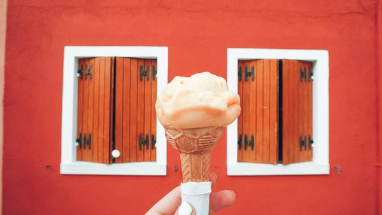
    Eating here
    <h2>How to tell real gelato from the tourist stuff</h2>
    
Flat covered tins, grey banana, khaki pistachio, and never blue. Four rules that take three seconds each, plus six gelaterie in Florence that pass them.

    Checked October 2026 &middot; 6 places
  </a>
  <a class="artcard has-photo" href="/articles/how-to-stay-cool-in-florence-in-summer/">
    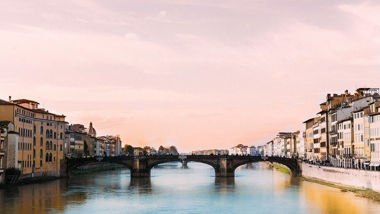
    Summer in the city
    <h2>How to stay cool in Florence in summer</h2>
    
The open-air public pools Florentines use, the cool places, and how to plan a day around the heat.

    Researched November 2026
  </a>
  <a class="artcard has-photo" href="/articles/beach-day-from-florence-by-train/">
    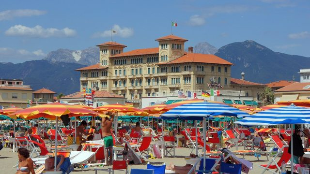
    Day trip
    <h2>A beach day from Florence by train</h2>
    
Viareggio in an hour and a half, around ten euro, no booking. How the beaches work, and where else to go.

    Researched November 2026
  </a>
  <a class="artcard has-photo" href="/articles/summer-evenings-in-florence/">
    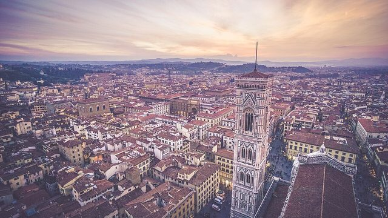
    Evenings
    <h2>Summer evenings in Florence</h2>
    
Free films in front of the Uffizi, cinema in cloisters and villa gardens, and the Roman theatre in Fiesole.

    Researched November 2026
  </a>
  <a class="artcard has-photo" href="/articles/san-giovanni-in-florence/">
    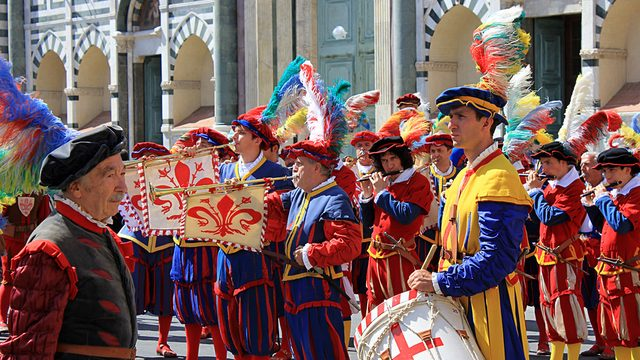
    24 June
    <h2>San Giovanni: Florence's own holiday</h2>
    
The Calcio Storico final in Piazza Santa Croce and fireworks over the Arno. How to see both.

    Researched November 2026
  </a>

</section>

<section class="artsec" id="all-year">
<h2 class="artsec-title">🗓️ All year</h2>

Planning a visit, eating, working and getting around the city.

  <a class="artcard has-photo" href="/articles/are-two-days-enough-for-florence/">
    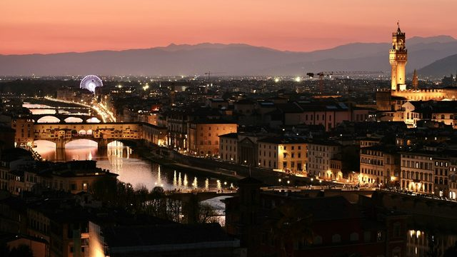
    Planning
    <h2>Are 2 days enough for Florence?</h2>
    
Yes, under one hard rule: one booked museum per day. What to cut, what to book, and the three things that eat the most time.

    Checked October 2026
  </a>
  <a class="artcard has-photo" href="/articles/what-not-to-miss-in-florence/">
    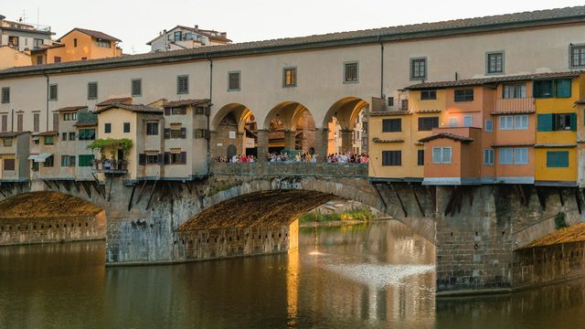
    First visit
    <h2>What should you not miss in Florence?</h2>
    
Six things worth the time, the two you need to book, and the famous sights it is fine to walk past.

    Checked October 2026
  </a>
  <a class="artcard has-photo" href="/articles/what-to-avoid-in-florence/">
    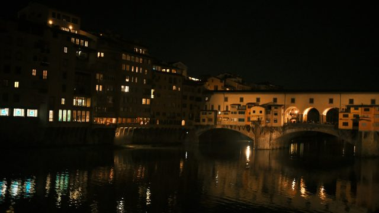
    Tourist traps
    <h2>What to avoid in Florence</h2>
    
Where the good version of everything sits: three streets off the main squares. Restaurants, sandwich queues, and gelato that is not really gelato.

    Checked October 2026
  </a>
  <a class="artcard has-photo" href="/articles/florence-off-the-tourist-track/">
    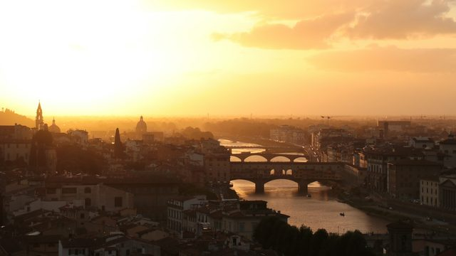
    Away from the centre
    <h2>Cool things to do in Florence, away from the tourist track</h2>
    
A hillside boulevard nobody walks, a house full of armoured knights, a lane out of San Niccolo, and the river itself.

    Checked October 2026 &middot; 8 places
  </a>
  <a class="artcard has-photo" href="/articles/florence-with-children/">
    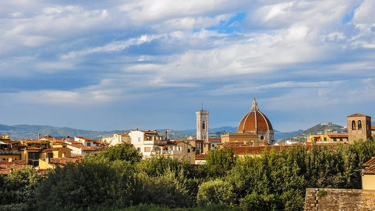
    With children
    <h2>What to do in Florence with children</h2>
    
The museums built for children rather than adapted for them, the parks Florentine families actually use, the antique carousel, and how to get onto the Arno.

    Checked October 2026 &middot; 8 places
  </a>
  <a class="artcard has-photo" href="/articles/work-from-a-cafe-in-florence/">
    
    Working here
    <h2>Can you work from a cafe in Florence?</h2>
    
Yes, and in most cafes nobody will stop you. The etiquette nobody explains, the hours to avoid, and five places where a laptop is already normal.

    Checked October 2026 &middot; 5 places
  </a>
  <a class="artcard has-photo" href="/articles/florence-markets/">
    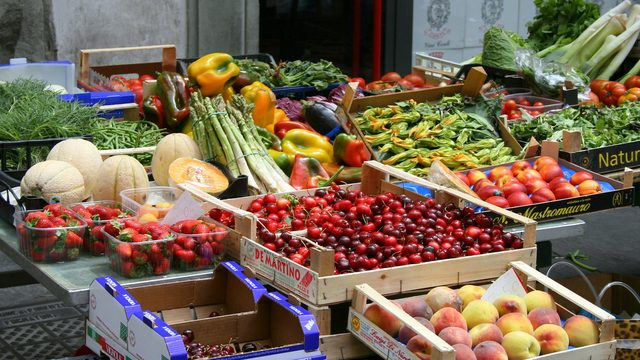
    Shopping
    <h2>Florence's markets, and which one is for what</h2>
    
Sant'Ambrogio for food, the Mercato Centrale, the leather stalls, and the weekly and monthly markets.

    Researched November 2026
  </a>
  <a class="artcard has-photo" href="/articles/aperitivo-in-florence/">
    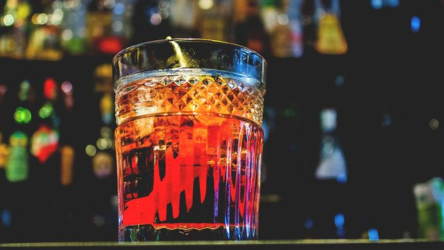
    Drinks
    <h2>Aperitivo in Florence: where and how</h2>
    
Three wine bars, Santo Spirito at sunset, the Negroni, and the little wine windows in the walls.

    Researched November 2026
  </a>
  <a class="artcard has-photo" href="/articles/getting-around-florence/">
    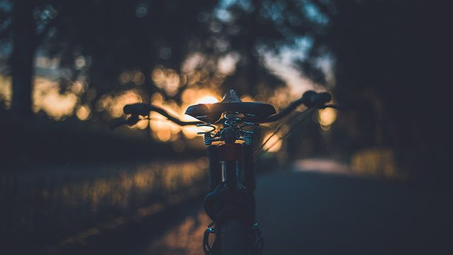
    Practical
    <h2>Getting around Florence: tram, bus, taxi and the ZTL</h2>
    
The airport tram, the new 2 euro ticket, fixed taxi fares, and why never to drive into the centre.

    Researched November 2026
  </a>
  <a class="artcard has-photo" href="/articles/free-museums-in-florence/">
    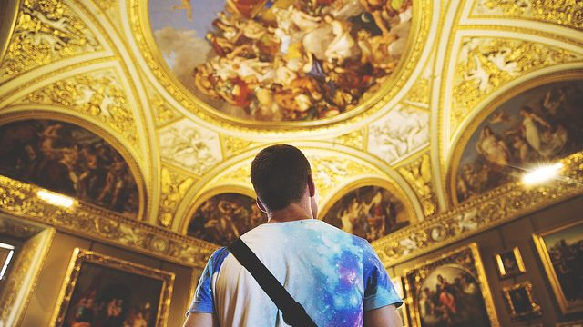
    Saving money
    <h2>Free museums in Florence, and the first Sunday</h2>
    
The Uffizi, the Accademia and the Pitti for nothing once a month, and what is free every day.

    Researched November 2026
  </a>
  <a class="artcard has-photo" href="/articles/day-trips-from-florence-by-train/">
    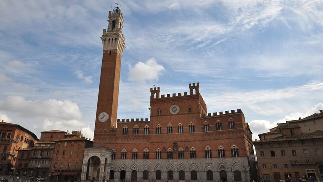
    Day trips
    <h2>Day trips from Florence by train</h2>
    
Pisa, Lucca, Bologna, Arezzo and Pistoia in under two hours, and when the bus beats the train to Siena.

    Researched November 2026
  </a>

</section>

